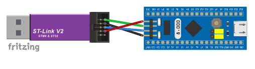

# Errata zum Make STM32-Special

Hier sammeln wir Korrekturen und Ergänzungen zum Make-Sonderheft **STM32-Special**.

## Seite 19 – Fehlerhafte Verdrahtung von Blue Pill und ST-Link

Im Kasten **„Reihenfolge der Pins beachten“** ist die Verkabelung zwischen der Blue Pill und dem ST-Link in **Bild 9** fehlerhaft dargestellt.

**Bitte verwendet nicht die im Heft abgebildete Verdrahtung.**

Die folgende Abbildung zeigt die korrekte Verbindung:

### Korrekte Pinbelegung

| ST-Link | Blue Pill |
| ------- | --------- |
| 3,3 V   | 3V3       |
| GND     | GND       |
| SWDIO   | DIO       |
| SWCLK   | CLK       |

**Wichtig:** Achtet beim Anschließen auf die tatsächliche Pinbelegung eures ST-Link-Adapters. Die Anordnung der Anschlüsse kann je nach Modell abweichen.

Wir bitten um Entschuldigung für den Fehler.
